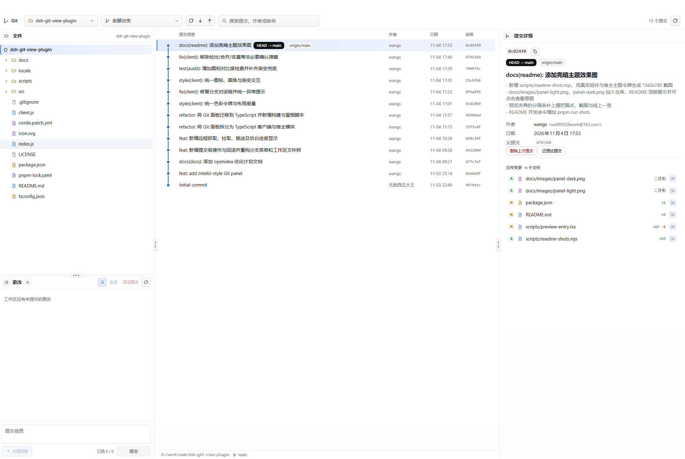
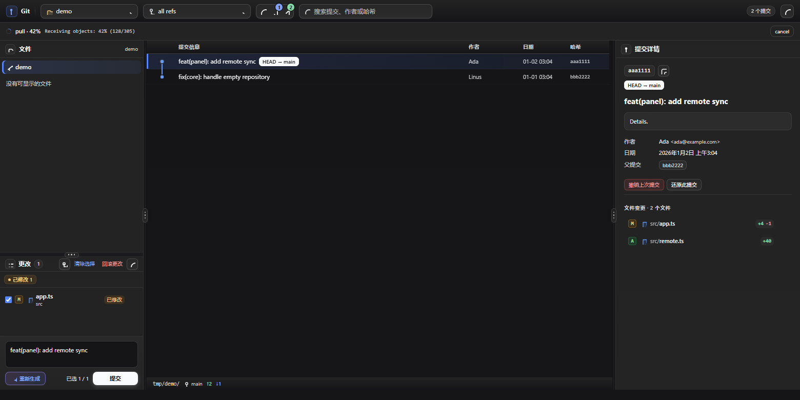

# Git Graph — DSH 插件

在 DSH Web 中加入 IntelliJ IDEA 风格的 Git 工作台：左侧工作区文件树与提交区、中间彩色提交图、右侧提交详情。支持中英文、亮暗主题、分栏拖拽和紧凑布局。

| 亮色主题 | 暗色主题 |
| --- | --- |
| [](docs/images/panel-light.png) | [](docs/images/panel-dark.png) |

## 功能

- **工作区与历史**：文件树包含已跟踪和未跟踪文件（遵守 .gitignore），带状态标记；选择文件/目录可缩小历史范围，分支筛选时展示对应历史树。
- **提交图与详情**：彩色泳道、refs、作者、日期、哈希、搜索；完整消息、父提交跳转和范围内的文件列表；双栏 diff 带行号、hunk、同步滚动及二进制/截断提示。
- **部分提交**：文件默认全选，可按列表或目录树选择；支持手写消息，或让 AI 生成 `type(scope): 描述` 草稿，确认后自行提交。
- **分支操作**：在分支行的「⋯」菜单检出、创建、重命名、删除、合并、变基；单击分支行只筛选历史，不检出。
- **历史操作**：提交行右键、行尾菜单或详情按钮支持复制、检出、拣选、还原、撤销上次提交；按提交状态限制操作，merge commit 不支持 undo / revert / cherry-pick。
- **回滚与进行中操作**：单文件撤回、批量回滚（可选择是否删除新增文件本地副本）；状态栏与提交区提供继续/中止入口。
- **远程同步**：抓取、拉取、推送，带进度和取消；拉取 Shift+点击使用 rebase，推送 Shift+点击使用 `--force-with-lease`。无上游时自动设置（优先 origin，否则首个 remote），推送范围始终明确为单分支。
- **反馈与状态**：统一异常横幅、读取错误卡片，操作后刷新；更改列表每 20 秒刷新，页面隐藏时暂停。

## 使用

前提：插件已在目标 DSH profile 中安装启用，系统 Git 可用，仓库目录已加入 DSH 工作区。仓库子目录也可用，Host 会解析真实仓库根目录。

1. 点击侧边栏 **Git** 图标，选择仓库。
2. 在分支下拉单击筛选历史，或点击该行「⋯」执行分支操作；在左树选择文件/目录缩小范围。
3. 勾选要提交的文件，手写消息或点击 **生成信息**，检查后点击 **提交**；快捷键为 `Ctrl+Enter` / `⌘+Enter`。
4. 使用顶部抓取 / 拉取 / 推送按钮同步远程；它们直接执行，Shift 修饰行为见上文，失败通过异常横幅报告。
5. 放弃更改时使用撤回或 **回滚更改**；检查文件列表和“删除新增文件”选项后再确认。
6. 提交行右键或行尾「⋯」打开历史操作，详情区提供相应快捷入口。

新建/重命名分支需要输入；删除分支、丢弃文件、批量回滚、中止操作会确认。检出、合并、变基、拣选、还原、撤销提交、拉取、推送直接执行，**直接执行不代表没有风险**。

> AI 生成会把选中文件的 diff 发送给当前默认模型，只起草消息，不自动 commit / push。回滚删除的未跟踪文件可能无法恢复；强推仍会改写远程历史。凭据使用本机 SSH agent / credential helper，面板不弹交互式密码输入。

## 快速开发

Node.js ≥22，pnpm 版本由 [manifest](package.json) 固定。克隆仓库后：

```sh
pnpm install --frozen-lockfile
pnpm run verify
```

verify 包含工程检查、工具回归、类型检查、构建和五组 smoke。视觉检查另用 `pnpm run audit`（不是 `pnpm audit`），临时截图用 `pnpm run preview`。

源码在 `src/host/` 与 `src/client/`，根目录 [index.js](index.js) / [client.js](client.js) 是 DSH 实际加载、纳入 Git 的生成产物，**不要手改或删除**。不使用 dist 目录。build 不保证运行中 DSH 自动更新，两端的宿主加载方式见 [开发文档](docs/development.md#dsh-中验证更新)。

## 维护导航

| 入口 | 内容 |
| --- | --- |
| [项目约束](AGENTS.md) | 分层、Git 安全不变量、验证与交付要求 |
| [项目 skill](.agents/skills/git-view-maintenance/SKILL.md) | 维护与审查的可复用步骤，DSH 可发现的项目级 skill |
| [文档索引](docs/README.md) | 全部现行文档与历史资料导航 |
| [架构](docs/architecture.md) | 双端模块、HTTP、写锁、远程与 AI 生命周期 |
| [开发与验证](docs/development.md) | 环境、命令、测试能力边界、更新排查与 CI |
| [维护与安全](docs/maintenance.md) | 文件清理、分发检查、可信仓库假设与已知限制 |
| [UI 设计规范](docs/ui-design-system.md) | 样式令牌、几何、亮暗主题审计 |

插件不是隔离不可信 Git hooks / filters 的沙箱；写锁只约束插件自身，不能替代 Git 对外部进程的并发保护。更多限制见 [安全边界](docs/maintenance.md#安全边界)。

## 许可

[Apache-2.0](LICENSE)。
